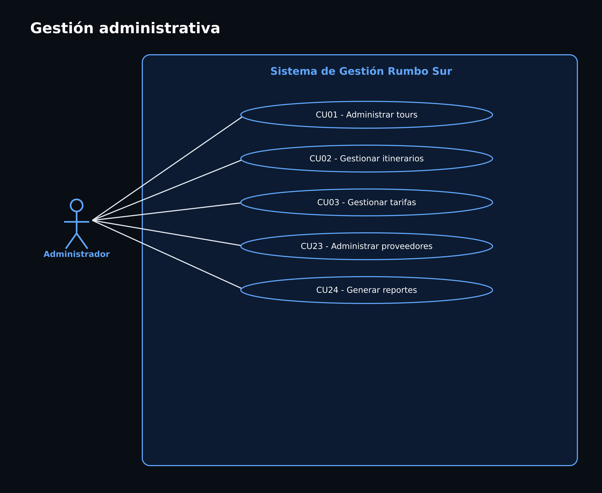
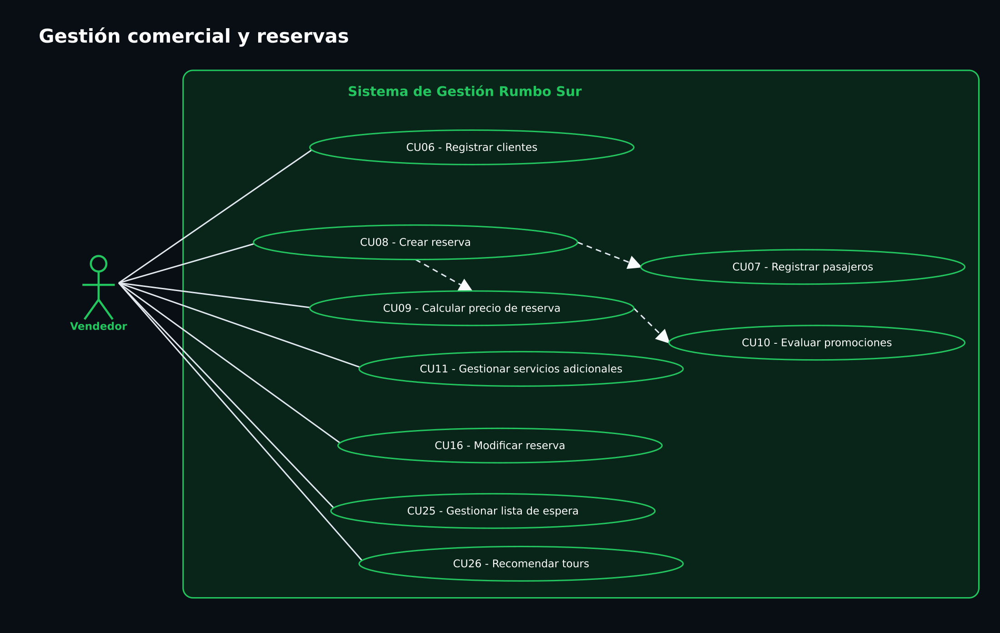
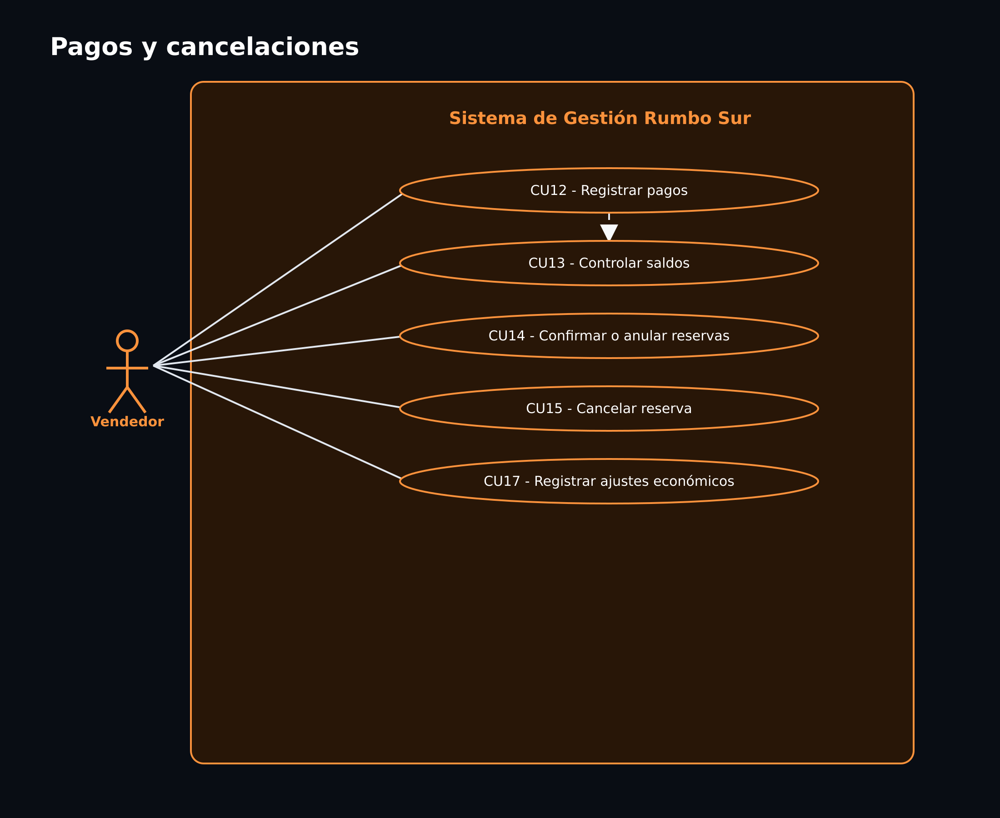
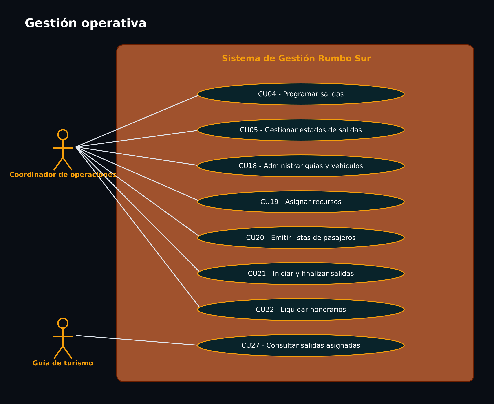

# 2. Diagrama de casos de uso

Los casos de uso se identificaron a partir de los 26 requerimientos funcionales (RF01–RF26), las reglas de negocio RN01–RN35 y los supuestos S01–S17.

Se consideran actores directos del sistema al Administrador, al Vendedor y al Coordinador de operaciones. Adicionalmente, se propone que el Guía de turismo pueda consultar sus salidas asignadas, de acuerdo con el supuesto S01.

El Cliente y el Proveedor participan de los procesos del negocio, pero no interactúan directamente con el software en esta primera versión.

Los casos de uso se organizaron por módulos para facilitar la lectura de los diagramas. El Vendedor aparece en gestión comercial y en pagos, pero representa un único actor.

Los códigos CU identifican casos de uso y no deben confundirse con los códigos RF, RN o S.

## 2.1. Identificación de casos de uso

| Actor | Responsabilidad | Casos de uso |
|---|---|---|
| Administrador | Catálogo de tours, itinerarios, tarifas, proveedores y reportes | CU01, CU02, CU03, CU23, CU24 |
| Vendedor | Clientes, reservas, precios, pagos, cancelaciones y funcionalidades complementarias | CU06–CU17, CU25, CU26 |
| Coordinador de operaciones | Salidas, recursos, listas de pasajeros y honorarios | CU04, CU05, CU18–CU22 |
| Guía de turismo | Consulta de salidas asignadas, propuesta mediante S01 | CU27 |

### Gestión administrativa

Comprende la administración del catálogo de tours, itinerarios, tarifas, proveedores y reportes.

### Gestión comercial y reservas

Comprende el registro de clientes y pasajeros, la creación y modificación de reservas, el cálculo de precios, la evaluación de promociones, los servicios adicionales, la lista de espera y las recomendaciones.

### Gestión de pagos y cancelaciones

Comprende el registro de pagos, el control de saldos, la confirmación o anulación de reservas, las cancelaciones y los ajustes económicos.

### Gestión operativa

Comprende la programación de salidas, la administración y asignación de recursos, la emisión de listas de pasajeros, el inicio y finalización de salidas y la liquidación de honorarios.

## 2.2. Diagramas UML de casos de uso

Los diagramas UML representan gráficamente las interacciones entre los actores y las funcionalidades del Sistema de Gestión Rumbo Sur.

Se utilizaron asociaciones mediante líneas continuas para indicar qué funcionalidades puede ejecutar cada actor.

Las relaciones «include» se utilizan cuando un caso de uso requiere obligatoriamente otro comportamiento modelado como caso de uso independiente.

Las condiciones de negocio y los escenarios alternativos se documentan en las descripciones textuales. No se incorporan relaciones «extend» artificiales entre funcionalidades independientes.

### 2.2.2. Gestión administrativa

El Administrador gestiona tours, itinerarios, tarifas y proveedores, y consulta reportes administrativos.

**Figura 2. Diagrama de casos de uso de gestión administrativa.**

### 2.2.3. Gestión comercial y reservas

El Vendedor registra clientes y pasajeros, crea y modifica reservas, calcula precios, evalúa promociones, gestiona servicios adicionales y utiliza las funcionalidades de lista de espera y recomendaciones.

**Figura 3. Diagrama de casos de uso de gestión comercial y reservas.**

### 2.2.4. Pagos y cancelaciones

El Vendedor registra pagos, controla saldos, confirma o anula reservas, gestiona cancelaciones y registra ajustes económicos.

**Figura 4. Diagrama de casos de uso de pagos y cancelaciones.**

### 2.2.5. Gestión operativa

El Coordinador de operaciones programa salidas, administra y asigna recursos, emite listas de pasajeros, inicia y finaliza salidas y liquida honorarios.

Se incorpora la consulta de salidas asignadas por parte del Guía de turismo como funcionalidad propuesta mediante S01.

**Figura 5. Diagrama de casos de uso de gestión operativa.**

## 2.3. Descripciones textuales de casos de uso

Las siguientes fichas describen el comportamiento esperado del sistema. Cada una incluye actor principal, objetivo, precondición, flujo principal, alternativas o excepciones, postcondición y trazabilidad.

### CU01 – Administrar tours

**Actor principal:** Administrador.

**Objetivo:** Registrar, consultar y modificar los tours ofrecidos por la agencia.

**Precondición:** Administrador autenticado.

**Flujo principal:**
1. El administrador selecciona la administración de tours.
2. Selecciona alta, consulta o modificación.
3. Informa código, nombre, descripción, categoría, duración y cupos.
4. El sistema valida los datos.
5. El sistema registra o actualiza el tour.

**Flujos alternativos:**
- Si el código está duplicado, se informa el error.
- Si existen datos inválidos, se solicita corregirlos.
- Si el tour está referenciado por otras operaciones, se restringen los cambios incompatibles.

**Postcondición:** Tour registrado o actualizado.

**Trazabilidad:** RF01 · RN01–RN02 · S02.

### CU02 – Gestionar itinerarios

**Actor principal:** Administrador.

**Objetivo:** Registrar y mantener las actividades que componen los itinerarios.

**Precondición:** Tour existente.

**Flujo principal:**
1. El administrador selecciona un tour.
2. Agrega, modifica u ordena actividades.
3. Informa día, horario, lugar y descripción.
4. Vincula servicios de proveedores cuando corresponda.
5. El sistema valida y guarda el itinerario.

**Flujos alternativos:**
- Si una actividad está incompleta, se solicita corrección.
- Si el día informado excede la duración del tour, se rechaza el registro.

**Postcondición:** Itinerario actualizado.

**Trazabilidad:** RF02 · RN01 · S02.

### CU03 – Gestionar tarifas

**Actor principal:** Administrador.

**Objetivo:** Administrar las tarifas de los tours según temporada.

**Precondición:** Tour existente.

**Flujo principal:**
1. El administrador selecciona un tour.
2. Selecciona temporada baja, media o alta.
3. Informa período de vigencia y tarifa base.
4. El sistema valida los datos.
5. El sistema registra la tarifa.

**Flujos alternativos:**
- Si existen períodos incompatibles o superpuestos, se solicita corrección.
- Si el importe no es válido, se rechaza el registro.

**Postcondición:** Tarifa disponible para el cálculo de reservas.

**Trazabilidad:** RF03 · RN12 · S16.

### CU04 – Programar salidas

**Actor principal:** Coordinador de operaciones.

**Objetivo:** Crear salidas programadas para los tours.

**Precondición:** Tour registrado y fechas válidas.

**Flujo principal:**
1. El coordinador selecciona un tour.
2. Informa las fechas de inicio y finalización.
3. Establece los cupos correspondientes.
4. El sistema valida fechas y capacidad.
5. Registra la salida en estado programada.
6. Cuando corresponde, se asignan recursos mediante CU19.

**Flujos alternativos:**
- Si los cupos no respetan los límites del tour, se rechaza el registro.
- Si las fechas son inconsistentes, se solicita corrección.

**Postcondición:** Salida programada.

**Trazabilidad:** RF04 · RN03–RN04 · S02.

### CU05 – Gestionar estados de salidas

**Actor principal:** Coordinador de operaciones.

**Objetivo:** Controlar los estados y la disponibilidad de las salidas.

**Precondición:** Salida registrada.

**Flujo principal:**
1. El coordinador consulta una salida.
2. El sistema verifica su ocupación y fecha.
3. Evalúa el cumplimiento del cupo mínimo y máximo.
4. Actualiza el estado cuando corresponda.
5. Muestra la disponibilidad resultante.

**Flujos alternativos:**
- Si faltan siete días y no se alcanzó el cupo mínimo, se cancela la salida y corresponde devolver el 100 % de los pagos.
- Si se alcanzó el cupo máximo, la salida queda completa y no admite nuevas reservas.

**Postcondición:** Estado y disponibilidad actualizados.

**Trazabilidad:** RF05 · RN04–RN07 · S04, S14.

### CU06 – Registrar clientes

**Actor principal:** Vendedor.

**Objetivo:** Registrar y consultar los datos de los clientes.

**Precondición:** Vendedor autenticado.

**Flujo principal:**
1. El vendedor selecciona la gestión de clientes.
2. Ingresa nombre, apellido, documento, teléfono, correo y país de residencia.
3. El sistema valida los datos.
4. Registra el cliente.
5. Permite consultarlo para futuras reservas.

**Flujos alternativos:**
- Si el documento ya existe, el sistema informa el registro correspondiente.
- Si faltan datos obligatorios, solicita completarlos.

**Postcondición:** Cliente disponible para realizar reservas.

**Trazabilidad:** RF06 · RN10 · S02.

### CU07 – Registrar pasajeros

**Actor principal:** Vendedor.

**Objetivo:** Incorporar pasajeros a una reserva.

**Precondición:** Reserva en preparación o susceptible de modificación.

**Flujo principal:**
1. El vendedor selecciona la reserva.
2. Registra los datos personales del pasajero.
3. Informa fecha de nacimiento, tipo de pasajero, contacto de emergencia y restricciones.
4. El sistema verifica los datos y las condiciones del tour.
5. Asocia el pasajero a la reserva.

**Flujos alternativos:**
- Si faltan datos obligatorios, se solicita completarlos.
- Si el pasajero no cumple los requisitos del tour, se impide su incorporación.

**Postcondición:** Pasajeros asociados a la reserva.

**Trazabilidad:** RF07 · RN10–RN13, RN19 · S03.

### CU08 – Crear reserva

**Actor principal:** Vendedor.

**Objetivo:** Registrar una reserva asociada a un cliente, una salida y sus pasajeros.

**Precondición:** Cliente y salida existentes; salida habilitada para reservas.

**Flujo principal:**
1. El vendedor selecciona un cliente.
2. Selecciona una salida programada.
3. Registra los pasajeros mediante CU07.
4. El sistema verifica los cupos y requisitos de participación.
5. Calcula el precio mediante CU09.
6. El vendedor incorpora los servicios adicionales correspondientes mediante CU11.
7. El sistema muestra el importe y las condiciones de pago.
8. El vendedor confirma el registro.
9. El sistema genera la reserva pendiente y retiene temporalmente los cupos según S04.

**Flujos alternativos:**
- **Cupos insuficientes:** se informa la falta de disponibilidad y puede gestionarse una solicitud de lista de espera mediante CU25.
- **Restricciones de participación:** se impide registrar la reserva con pasajeros que no cumplen las condiciones.
- **Reserva dentro de los diez días anteriores a la salida:** se exige el pago total durante la operación. La reserva queda confirmada únicamente cuando se registra el pago requerido.
- **Datos incompletos:** se solicita completar la información antes de guardar.

**Postcondición:** Reserva pendiente con cupos retenidos temporalmente, o confirmada cuando corresponda el pago total.

**Trazabilidad:** RF08 · RN10–RN21 · S03–S06, S14, S16.

### CU09 – Calcular precio de reserva

**Actor principal:** Vendedor.

**Objetivo:** Determinar el importe total de una reserva.

**Precondición:** Salida, pasajeros y tarifa disponibles.

**Flujo principal:**
1. El sistema identifica la temporada aplicable.
2. Determina la edad y el tipo de cada pasajero.
3. Aplica las tarifas correspondientes.
4. Evalúa las promociones mediante CU10.
5. Incorpora los servicios adicionales.
6. Muestra el importe total desglosado.

**Flujos alternativos:**
- Si no existe tarifa vigente, se impide finalizar el cálculo.
- Si faltan datos necesarios, se solicita completarlos.

**Postcondición:** Importe calculado y desglosado.

**Trazabilidad:** RF09 · RN12–RN19 · S03, S05, S06, S16.

### CU10 – Evaluar promociones

**Actor principal:** Vendedor.

**Objetivo:** Determinar qué promoción comercial corresponde aplicar.

**Precondición:** Fecha de reserva, pasajeros e importe base conocidos.

**Flujo principal:**
1. El sistema verifica si la reserva se realiza con más de 60 días de anticipación.
2. Verifica si incluye seis o más pasajeros.
3. Identifica las promociones aplicables.
4. Selecciona únicamente la más beneficiosa.
5. Devuelve el descuento correspondiente al cálculo del precio.

**Flujos alternativos:**
- Si ninguna promoción es aplicable, se mantiene el importe sin promoción comercial.

**Postcondición:** Promoción seleccionada o ausencia de promoción.

**Trazabilidad:** RF10 · RN15–RN17 · S05, S16.

### CU11 – Gestionar servicios adicionales

**Actor principal:** Vendedor.

**Objetivo:** Incorporar servicios adicionales a los pasajeros.

**Precondición:** Tour y pasajeros identificados.

**Flujo principal:**
1. El vendedor consulta los servicios disponibles.
2. Selecciona excursiones opcionales, traslados o seguros.
3. Asocia los servicios a los pasajeros correspondientes.
4. El sistema verifica los servicios obligatorios.
5. Actualiza el importe de la reserva.

**Flujos alternativos:**
- Si el tour es de aventura y falta el seguro obligatorio, se exige incorporarlo.
- Si el servicio seleccionado no está disponible, se rechaza la selección.

**Postcondición:** Servicios adicionales asociados a los pasajeros.

**Trazabilidad:** RF11 · RN18–RN19 · S06.

### CU12 – Registrar pagos

**Actor principal:** Vendedor.

**Objetivo:** Registrar señas y pagos de reservas.

**Precondición:** Reserva vigente e importe adeudado determinado.

**Flujo principal:**
1. El vendedor selecciona una reserva.
2. Ingresa fecha, importe y medio de pago.
3. Si corresponde, indica la cantidad de cuotas.
4. El sistema calcula el recargo por financiación con tarjeta.
5. Registra el pago.
6. Actualiza el saldo mediante CU13.
7. Evalúa las condiciones de confirmación de la reserva.

**Flujos alternativos:**
- Si el pago es inválido, se solicita corrección.
- Si se alcanza la seña requerida, se evalúa la confirmación mediante CU14.

**Postcondición:** Pago registrado y saldo actualizado.

**Trazabilidad:** RF12 · RN20–RN22 · S04, S16.

### CU13 – Controlar saldos

**Actor principal:** Vendedor.

**Objetivo:** Consultar y controlar los saldos pendientes de las reservas.

**Precondición:** Reserva con importe y pagos registrados.

**Flujo principal:**
1. El vendedor selecciona una reserva.
2. El sistema obtiene su importe total.
3. Consulta los pagos registrados.
4. Calcula el saldo pendiente.
5. Verifica la fecha límite de pago.
6. Informa el estado de cumplimiento.

**Flujos alternativos:**
- Si el saldo se encuentra vencido, se evalúa la anulación correspondiente mediante CU14.

**Postcondición:** Saldo y estado de cumplimiento disponibles.

**Trazabilidad:** RF13 · RN20–RN21 · S04, S14.

### CU14 – Confirmar o anular reservas

**Actor principal:** Vendedor.

**Objetivo:** Gestionar la confirmación o anulación de reservas según las condiciones de pago y los plazos establecidos.

**Precondición:** Reserva existente con importe, pagos y fechas disponibles.

**Flujo principal:**
1. El vendedor selecciona la reserva.
2. El sistema consulta los pagos registrados.
3. Verifica los plazos aplicables.
4. Si se alcanzó la seña mínima del 30 %, o el pago total cuando corresponda, confirma la reserva.
5. Actualiza el estado y conserva los cupos asignados.

**Flujos alternativos:**
- Si el pago es insuficiente y el plazo continúa vigente, la reserva permanece pendiente.
- Si vence el plazo de una reserva pendiente o el plazo para cancelar el saldo, el sistema anula la reserva y libera los cupos.
- Si la reserva ya está anulada, se impide su confirmación.

**Postcondición:** Reserva confirmada, pendiente o anulada según las condiciones verificadas.

**Trazabilidad:** RF14 · RN20–RN21 · S04, S14.

### CU15 – Cancelar reserva

**Actor principal:** Vendedor.

**Objetivo:** Registrar cancelaciones y calcular devoluciones.

**Precondición:** Reserva existente susceptible de cancelación.

**Flujo principal:**
1. El vendedor selecciona la reserva.
2. Indica motivo y fecha de cancelación.
3. El sistema calcula los días calendario hasta la salida.
4. Determina el porcentaje de devolución correspondiente.
5. Registra la cancelación y la devolución.
6. Libera los cupos de la reserva.

**Flujos alternativos:**
- Si la agencia cancela, corresponde una devolución del 100 %.
- Si el cliente cancela con menos de siete días de anticipación, no corresponde devolución.

**Postcondición:** Reserva cancelada y devolución registrada según la política aplicable.

**Trazabilidad:** RF15 · RN23–RN27 · S15.

### CU16 – Modificar reserva

**Actor principal:** Vendedor.

**Objetivo:** Modificar reservas y gestionar reemplazos de pasajeros.

**Precondición:** Reserva existente y salida no iniciada.

**Flujo principal:**
1. El vendedor selecciona una reserva.
2. Indica la modificación solicitada.
3. El sistema verifica plazos y condiciones.
4. Valida los requisitos del pasajero y los cupos cuando corresponda.
5. Recalcula importes si es necesario.
6. Registra la modificación.

**Flujos alternativos:**
- Si se solicita un reemplazo fuera del plazo permitido, se rechaza.
- Si el nuevo pasajero no cumple las condiciones del tour, se impide el cambio.
- Si no hay cupos suficientes para la modificación, no se aplica.

**Postcondición:** Reserva actualizada y modificación registrada.

**Trazabilidad:** RF16 · RN10–RN11, RN28 · S03, S15.

### CU17 – Registrar ajustes económicos

**Actor principal:** Vendedor.

**Objetivo:** Registrar correcciones económicas sin eliminar movimientos originales.

**Precondición:** Reserva pagada con un movimiento que requiere corrección.

**Flujo principal:**
1. El vendedor selecciona el movimiento.
2. Informa el motivo del ajuste.
3. Indica el importe correspondiente.
4. El sistema valida la operación.
5. Registra una nota de ajuste sin eliminar el pago original.

**Flujos alternativos:**
- Si falta el motivo o el ajuste es inconsistente, se rechaza.

**Postcondición:** Ajuste registrado y trazabilidad económica conservada.

**Trazabilidad:** RF17 · RN33 · S02.

### CU18 – Administrar guías y vehículos

**Actor principal:** Coordinador de operaciones.

**Objetivo:** Registrar y consultar los recursos operativos.

**Precondición:** Coordinador autenticado.

**Flujo principal:**
1. El coordinador accede a la gestión de recursos.
2. Registra o consulta guías, habilitaciones, idiomas y honorarios.
3. Registra o consulta vehículos, patentes, tipos y capacidades.
4. El sistema valida la información.
5. Guarda los datos correspondientes.

**Flujos alternativos:**
- Si existen datos duplicados o inválidos, se solicita corrección.
- Si faltan habilitaciones necesarias, se informa la situación.

**Postcondición:** Recursos registrados y disponibles para asignación.

**Trazabilidad:** RF18 · RN08–RN09 · S02.

### CU19 – Asignar recursos

**Actor principal:** Coordinador de operaciones.

**Objetivo:** Asignar guías y vehículos a las salidas.

**Precondición:** Salida, guía y vehículo registrados.

**Flujo principal:**
1. El coordinador selecciona una salida.
2. Selecciona el guía y el vehículo.
3. El sistema verifica la disponibilidad del guía.
4. Controla sus habilitaciones.
5. Verifica la capacidad del vehículo.
6. Registra la asignación.

**Flujos alternativos:**
- Si el guía tiene otra salida superpuesta, se rechaza.
- Si no está habilitado para el tour, se impide la asignación.
- Si el vehículo no tiene capacidad suficiente, se solicita otro recurso.

**Postcondición:** Guía y vehículo asignados a la salida.

**Trazabilidad:** RF19 · RN08–RN09 · S02.

### CU20 – Emitir lista de pasajeros

**Actor principal:** Coordinador de operaciones.

**Objetivo:** Generar la lista operativa de pasajeros de una salida.

**Precondición:** Salida con reservas vigentes.

**Flujo principal:**
1. El coordinador selecciona la salida.
2. El sistema obtiene los pasajeros correspondientes.
3. Reúne documentos, contactos de emergencia y restricciones relevantes.
4. Genera la lista.
5. Registra que la lista fue emitida.

**Flujos alternativos:**
- Si faltan datos obligatorios, se solicita completarlos antes de emitirla.

**Postcondición:** Lista de pasajeros disponible para la operación.

**Trazabilidad:** RF20 · RN29–RN30 · S01.

### CU21 – Iniciar y finalizar salidas

**Actor principal:** Coordinador de operaciones.

**Objetivo:** Registrar el inicio y la finalización de salidas.

**Precondición:** Salida existente en un estado compatible con la operación.

**Flujo principal:**
1. El coordinador selecciona la salida.
2. Solicita iniciar la operación.
3. El sistema verifica que exista un guía asignado y una lista de pasajeros emitida.
4. Cambia el estado a en curso.
5. Al concluir, el coordinador registra la finalización.
6. El sistema cambia el estado a finalizada.

**Flujos alternativos:**
- Si falta el guía o la lista, no se permite iniciar.
- Si el estado de la salida es incompatible, se impide la transición.

**Postcondición:** Salida en curso o finalizada según la operación registrada.

**Trazabilidad:** RF21 · RN04, RN29–RN31 · S01.

### CU22 – Liquidar honorarios

**Actor principal:** Coordinador de operaciones.

**Objetivo:** Calcular y registrar los honorarios de los guías.

**Precondición:** Salida finalizada con guía asignado.

**Flujo principal:**
1. El coordinador selecciona una salida finalizada.
2. El sistema obtiene los días trabajados.
3. Consulta el honorario fijo diario.
4. Calcula el 5 % de las ventas de servicios adicionales.
5. Determina el importe total.
6. Registra la liquidación.

**Flujos alternativos:**
- Si la salida no está finalizada, se impide liquidar.
- Si faltan datos necesarios, se solicita completarlos.

**Postcondición:** Honorarios calculados y registrados.

**Trazabilidad:** RF22 · RN31–RN32 · S02.

### CU23 – Administrar proveedores

**Actor principal:** Administrador.

**Objetivo:** Registrar y consultar proveedores de servicios turísticos.

**Precondición:** Administrador autenticado.

**Flujo principal:**
1. El administrador accede a la gestión de proveedores.
2. Registra o consulta nombre, CUIT, contacto y tipo de servicio.
3. El sistema valida la información.
4. Registra o actualiza el proveedor.

**Flujos alternativos:**
- Si el CUIT es inválido o está duplicado, se solicita corrección.

**Postcondición:** Proveedor disponible para su vinculación con los servicios turísticos.

**Trazabilidad:** RF23 · RN01 · S02.

### CU24 – Generar reportes

**Actor principal:** Administrador.

**Objetivo:** Obtener reportes administrativos y operativos.

**Precondición:** Información de operaciones registrada.

**Flujo principal:**
1. El administrador selecciona el tipo de reporte.
2. Elige ocupación, ventas por vendedor, ingresos por tour o cancelaciones.
3. Establece los filtros correspondientes.
4. El sistema procesa la información.
5. Muestra el reporte.

**Flujos alternativos:**
- Si no existen datos, se presenta un reporte vacío con una aclaración.
- Si los filtros son inválidos, se solicita corregirlos.

**Postcondición:** Reporte generado y disponible para consulta.

**Trazabilidad:** RF24 · RN04–RN07, RN20–RN27 · S11.

### CU25 – Gestionar lista de espera

**Actor principal:** Vendedor.

**Objetivo:** Registrar solicitudes para salidas completas y gestionar ofertas de cupos liberados.

**Precondición:** Salida completa y cliente identificado.

**Flujo principal:**
1. El vendedor selecciona una salida completa.
2. Registra la solicitud del cliente y la cantidad de pasajeros.
3. El sistema guarda fecha y hora de inscripción.
4. Cuando se liberan cupos, identifica la solicitud compatible más antigua.
5. El vendedor comunica la oferta.
6. Si el cliente acepta, se inicia CU08 con una nueva verificación de disponibilidad.

**Flujos alternativos:**
- Si no hay cupos suficientes para la primera solicitud, conserva su prioridad y evalúa las siguientes compatibles.
- Si el cliente rechaza la oferta, se retira la solicitud.
- Si no responde dentro de las 24 horas, la oferta y la solicitud se marcan como vencidas.
- La inscripción en lista de espera no genera una reserva ni ocupa cupos.

**Postcondición:** Solicitud vigente, atendida, retirada o vencida, según corresponda.

**Trazabilidad:** RF25 · RN34 · S07, S08, S13.

### CU26 – Recomendar tours

**Actor principal:** Vendedor.

**Objetivo:** Recomendar tours según las preferencias del cliente.

**Precondición:** Catálogo de tours disponible y preferencias identificadas cuando corresponda.

**Flujo principal:**
1. El vendedor registra o consulta las preferencias del cliente.
2. El sistema considera categoría, presupuesto y fechas.
3. Filtra tours y salidas disponibles.
4. Verifica las condiciones de participación.
5. Muestra recomendaciones y tarifas correspondientes.

**Flujos alternativos:**
- Si no existen coincidencias, informa la situación y permite modificar los filtros.
- Las recomendaciones no generan reservas ni retienen cupos automáticamente.

**Postcondición:** Recomendaciones mostradas sin modificar las reservas.

**Trazabilidad:** RF26 · RN35 · S09, S10, S17.

### CU27 – Consultar salidas asignadas

**Actor principal:** Guía de turismo.

**Objetivo:** Consultar las salidas asignadas y la información operativa autorizada.

**Precondición:** Acceso de consulta implementado y guía identificado.

**Flujo principal:**
1. El guía ingresa al módulo de consulta.
2. El sistema identifica sus salidas asignadas.
3. Muestra la información operativa correspondiente.
4. Permite consultar los datos autorizados de los pasajeros.
5. Finaliza la consulta sin modificar registros.

**Flujos alternativos:**
- Si no tiene salidas asignadas, se informa la situación.
- Si intenta acceder a una salida ajena, se deniega el acceso.

**Postcondición:** Información consultada sin modificaciones.

**Trazabilidad:** S01 · RN29–RN30.

**Aclaración:** CU27 es una funcionalidad propuesta mediante S01 y no corresponde a un requerimiento funcional original.

## 2.4. Matriz de trazabilidad

La siguiente matriz vincula cada caso de uso con su requerimiento funcional principal y el actor responsable.

| CU | Caso de uso | RF / Supuesto | Actor |
|---|---|---|---|
| CU01 | Administrar tours | RF01 | Administrador |
| CU02 | Gestionar itinerarios | RF02 | Administrador |
| CU03 | Gestionar tarifas | RF03 | Administrador |
| CU04 | Programar salidas | RF04 | Coordinador |
| CU05 | Gestionar estados de salidas | RF05 | Coordinador |
| CU06 | Registrar clientes | RF06 | Vendedor |
| CU07 | Registrar pasajeros | RF07 | Vendedor |
| CU08 | Crear reserva | RF08 | Vendedor |
| CU09 | Calcular precio de reserva | RF09 | Vendedor |
| CU10 | Evaluar promociones | RF10 | Vendedor |
| CU11 | Gestionar servicios adicionales | RF11 | Vendedor |
| CU12 | Registrar pagos | RF12 | Vendedor |
| CU13 | Controlar saldos | RF13 | Vendedor |
| CU14 | Confirmar o anular reservas | RF14 | Vendedor |
| CU15 | Cancelar reserva | RF15 | Vendedor |
| CU16 | Modificar reserva | RF16 | Vendedor |
| CU17 | Registrar ajustes económicos | RF17 | Vendedor |
| CU18 | Administrar guías y vehículos | RF18 | Coordinador |
| CU19 | Asignar recursos | RF19 | Coordinador |
| CU20 | Emitir lista de pasajeros | RF20 | Coordinador |
| CU21 | Iniciar y finalizar salidas | RF21 | Coordinador |
| CU22 | Liquidar honorarios | RF22 | Coordinador |
| CU23 | Administrar proveedores | RF23 | Administrador |
| CU24 | Generar reportes | RF24 | Administrador |
| CU25 | Gestionar lista de espera | RF25 | Vendedor |
| CU26 | Recomendar tours | RF26 | Vendedor |
| CU27 | Consultar salidas asignadas | S01 (propuesto) | Guía de turismo |

Las reglas de negocio y los supuestos específicos se encuentran referenciados en las fichas textuales del apartado 2.3.

## 2.5. Aclaraciones del modelado

### Diferencia entre salida confirmada y reserva confirmada

Una salida se confirma cuando alcanza el cupo mínimo establecido, de acuerdo con RN05.

Una reserva se confirma cuando cumple las condiciones de pago establecidas en RN20 y S04.

Ambas confirmaciones corresponden a procesos y estados diferentes.

### Ocupación de cupos

Todos los pasajeros ocupan un lugar, incluidos los menores de tres años que no abonan tarifa.

Las reservas pendientes pueden retener cupos temporalmente, de acuerdo con S04 y S14.

La lista de espera no ocupa ni retiene cupos.

### Reservas próximas a la salida

Cuando una reserva se realiza dentro de los diez días anteriores al inicio de la salida, se exige el pago total durante el registro.

En ese caso, no se genera una reserva pendiente con cupos retenidos sin el pago correspondiente.

### Cálculo de precios

El cálculo considera el siguiente orden:

1. Tarifa de temporada.
2. Tarifa correspondiente al tipo de pasajero.
3. Aplicación de una única promoción comercial.
4. Incorporación de servicios adicionales.
5. Recargo por financiación con tarjeta en cuotas, cuando corresponda.

Este criterio responde a RN12–RN22 y a los supuestos S05, S06 y S16.

### Lista de espera

Las solicitudes se ordenan por fecha y hora de inscripción.

Cuando se liberan lugares, se identifica la solicitud más antigua que pueda satisfacerse completamente, respetando las condiciones de RN34.

Las ofertas tienen una vigencia propuesta de 24 horas.

Aceptar una oferta no confirma automáticamente una reserva. El vendedor debe registrar la operación y verificar nuevamente los cupos y las condiciones de pago.

### Recomendaciones

Las recomendaciones se generan mediante filtros determinísticos sobre los datos registrados.

No se utilizan servicios externos ni inteligencia artificial.

Las recomendaciones no garantizan disponibilidad futura ni generan reservas automáticamente.

### Acceso del guía

El acceso del Guía de turismo constituye una funcionalidad propuesta mediante S01.

Su incorporación definitiva depende de que el grupo implemente el módulo de consulta correspondiente.

### Criterios UML

Los actores se relacionan con los casos de uso mediante asociaciones.

Las relaciones «include» se utilizan para comportamientos obligatorios modelados como casos de uso independientes.

Los flujos alternativos y las excepciones se describen en las fichas textuales.

No se agregan relaciones «extend» cuando no existe una extensión funcional justificada.

La organización de los diagramas por módulos responde a criterios de claridad visual y no representa sistemas independientes.

## 2.6. Conclusión

El modelado de casos de uso permite identificar las funcionalidades del Sistema de Gestión Rumbo Sur, las responsabilidades de sus actores y las principales condiciones que deben respetarse durante su funcionamiento.

Los 27 casos de uso documentados mantienen correspondencia con los 26 requerimientos funcionales y con la funcionalidad adicional de consulta del guía propuesta mediante S01.

Este análisis constituye una base para elaborar los diagramas de clases y de secuencia y para desarrollar posteriormente la aplicación en Java, manteniendo la coherencia entre requerimientos, diseño e implementación.
